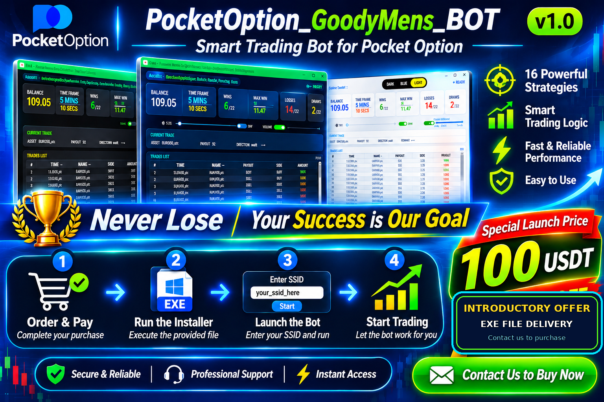

# PocketOption GoodyMens BOT v1.0

**Smart Trading Bot for Pocket Option**

Welcome to PocketOption GoodyMens BOT!

## 🚀 Features

- 16 Trading Strategies
- Smart Trading Logic
- Fast Performance
- Modern User Interface
- Easy to Use

## 💰 Special Launch Price

# 100 USDT

One-time introductory launch price.

## 📦 What You Get

- PocketOption GoodyMens BOT v1.0
- EXE Application Installer
- Installation Instructions
- SSID Setup Instructions

## ⚙️ Installation Guide

1. Complete your purchase.
2. Receive your EXE file via email.
3. Run the installer.
4. Enter your SSID.
5. Launch the application.

## 🛒 How to Purchase

1. Contact us via email.
2. Receive payment instructions.
3. Complete your payment in USDT.
4. After payment confirmation, receive your EXE file via email.

## 📩 Contact Us

**Email:** arazeskandarian@gmail.com

For purchasing and technical support, contact us via email.

## ⚠️ Risk Disclaimer

Trading involves financial risk. No trading bot can guarantee profits or eliminate losses.

Past performance does not guarantee future results.

Use the software responsibly.

---

**Product:** PocketOption GoodyMens BOT

**Version:** 1.0

**Price:** 100 USDT

---

## 👨‍💻 Developer & Programmer

Developed by: **Shahrouz Eskandarian**       @shahrouz_eskandarian

10 years of experience in trading strategy development and automated trading systems.
